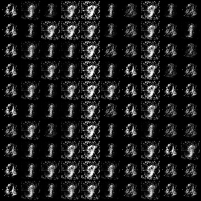
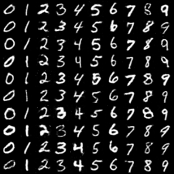
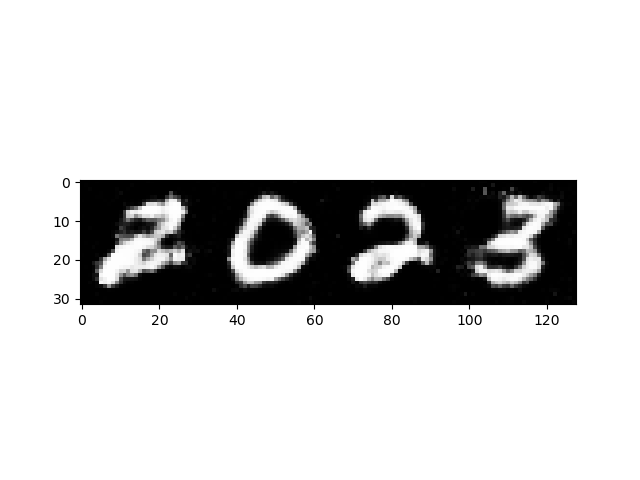

# cGAN

条件生成对抗网络（Conditional GAN）生成 **MNIST 手写数字**：给定标签 0–9 与一个 100 维噪声向量，生成对应类别的 32×32 灰度数字图像。含训练脚本、Gradio 采样 demo，以及从第 0 轮到第 50 轮的检查点与按迭代轮次落盘的生成样例。

## 项目简介

- 训练脚本改编自 [eriklindernoren/PyTorch-GAN](https://github.com/eriklindernoren/PyTorch-GAN/blob/master/implementations/cgan/cgan.py)（文件首行注明出处），核心改动是加了损失记录、按固定间隔保存 checkpoint（`--ckpt_interval`，默认 10 轮）、训练结束把 G/D 损失曲线落盘成 `images/loss_curve.png`；
- `app.py` 用 Gradio 4 做交互式采样：下拉选一个类别 + 滑杆选网格大小 n×n，模型用一个随机 `torch.randn` 噪声生成该类别的一批数字拼成网格图；
- 仓库里的 `images/` 是训练过程中每 400 次迭代自动保存的 10×10 数字网格，`checkpoint_*.pth` 是可以继续训练/直接采样的完整训练状态；
- `myplot.png` / `myplot2023.png` 是**旧版 `app.py`** 里把生成的第 2、0、2、3 号数字横向拼接得到的演示图（两张文件内容完全一致，MD5 相同），**不是损失曲线**；真正的损失曲线现在由 `cgan.py` 训练结束时写进 `images/loss_curve.png`。

## 效果展示

训练早期（第 400 次迭代）与后期（第 93600 次迭代）的生成网格，每行同一类别，左上到右下依次为 0–9 的采样：





旧版 `app.py` 留下的 "2023" 四字拼接演示（同一噪声维度下按类别 2、0、2、3 生成后横向拼合；现在的 `app.py` 只按单个类别生成 n×n 网格，不再产出这张图）：



单张 32×32 生成结果示例：


## 数据集

**MNIST**（`torchvision.datasets.MNIST`，`train=True`，60000 张），预处理：

```python
transforms.Compose([
    transforms.Resize(opt.img_size),          # 28×28 → 32×32（单边整数 Resize）
    transforms.ToTensor(),
    transforms.Normalize([0.5], [0.5]),       # 归一化到 [-1, 1]，与生成器末尾的 Tanh 输出区间匹配
])
```

- 类别数 `n_classes = 10`，图像尺寸 `img_size = 32`，通道 `channels = 1`（灰度）；
- 数据目录默认是**脚本同目录下的 `data/mnist`**（`--data_dir`，默认值由 `os.path.dirname(os.path.abspath(__file__))` 拼出的绝对路径），首次运行 `download=True` 自动下载。早期版本沿用上游项目的多层目录布局、把数据写到仓库外层的 `../../data/mnist`，现已改为仓库内路径；要换位置用 `--data_dir /path/to/mnist`。

## 模型 / 算法

### 生成器 G

把 10 维标签嵌入与 100 维噪声**先拼后送**（`torch.cat((label_emb(labels), noise), -1)`，输入维度 110）：

| 层 | 输出 | 说明 |
| --- | --- | --- |
| `nn.Embedding(10, 10)` | 10 | 类别标签嵌入 |
| `Linear(110, 128)` | 128 | 首层不做 BatchNorm（`normalize=False`） |
| `Linear(128, 256)` + `BN1d(0.8)` + `LeakyReLU(0.2)` | 256 | |
| `Linear(256, 512)` + `BN1d(0.8)` + `LeakyReLU(0.2)` | 512 | |
| `Linear(512, 1024)` + `BN1d(0.8)` + `LeakyReLU(0.2)` | 1024 | |
| `Linear(1024, 1024)` | 32×32 | `int(np.prod(img_shape))`，随后 `view(-1, 1, 32, 32)` |
| `Tanh()` | | 输出区间 [-1, 1] |

全连接结构（非卷积 GAN），`BatchNorm1d` 的 momentum 固定为 0.8。

### 判别器 D

把展平的图像（1024 维）与标签嵌入（10 维）拼接成 1034 维输入：

```
Linear(1034, 1024) → LeakyReLU(0.2)
Linear(1024, 512)  → Dropout(0.4) → LeakyReLU(0.2)
Linear(512, 256)   → Dropout(0.4) → LeakyReLU(0.2)
Linear(256, 1)                          # 输出实值，不做 Sigmoid
```

### 训练策略

- 损失：`nn.MSELoss()`（LSGAN 风格，真样本目标 1.0、假样本目标 0.0，而非 BCE）；
- 优化器：两个 `Adam(lr=2e-4, betas=(0.5, 0.999))`，G / D 各一个；
- 设备：`torch.device("cuda" if torch.cuda.is_available() else "cpu")`，模型 / 噪声 / 标签全部 `.to(device)`，**没有 GPU 会自动退回 CPU**（`num_workers` 与 `pin_memory` 也随之降级）；
- 每个 batch 先更新 G（用随机标签 `randint(0, 10)` 生成假样本骗 D），再更新 D（真样本 + `gen_imgs.detach()` 假样本，`d_loss = (d_real + d_fake) / 2`）；
- 默认超参：`n_epochs=50`、`batch_size=64`、`latent_dim=100`、`sample_interval=400`、`ckpt_interval=10`；
- 每 `sample_interval` 次迭代调用 `sample_image(n_row=10)`：采样 100 个噪声，标签按 `[num for _ in range(10) for num in range(10)]` 排列（每行同一类别），`save_image(..., nrow=10, normalize=True)` 存成 `<out_dir>/<batches_done>.png`（默认 `images/`）；
- 每 `ckpt_interval` 轮（默认 10）存一次 `checkpoint_{epoch+1}.pth`；若 `n_epochs` 不是 `ckpt_interval` 的整数倍，最后再补存一次 `checkpoint_{n_epochs}.pth`，保证总能拿到末轮权重；
- 每个 batch 把 `d_loss.item()` / `g_loss.item()` 追加进 `d_losses` / `g_losses`（**按迭代而非按 epoch 记录**），训练结束后用 matplotlib（`Agg` 后端）把 G/D 曲线保存为 `images/loss_curve.png` 并 `plt.close()`，不再阻塞式 `plt.show()`。

### 评估指标

GAN 无监督，仓库里没有 FID/IS 等量化指标，也没有目视对比的评测脚本。"进度指标"是 `images/` 下按迭代轮次排列的网格图、训练时打印的 `D loss` / `G loss`，以及训练结束落盘的 `images/loss_curve.png`（按迭代记录的两条损失曲线）。

## checkpoint 与 images 的对应关系

### `images/<数字>.png` 的命名

文件名 = `batches_done = epoch * len(dataloader) + i`，即**全局迭代次数（从 0 开始）**，每 400 次存一张：

- MNIST 60000 张 / batch 64 = 938 个 batch 每 epoch；
- 因此 `93600.png` ≈ `93600 / 938 ≈ 100` 个 epoch 末（说明这次实际跑了约 100 轮，而代码默认 `n_epochs=50`）；
- 仓库内共 **235 张**，从 `0.png` 到 `93600.png`，步长恰好 400；
- 每张是 10×10 = 100 个样本、342×342 像素（每个数字 32×32 加 margin），第 n 行全部是类别 n−1。

### `checkpoint_*.pth` 的结构

`checkpoint_{0,10,20,30,40,50}.pth` 都是 `torch.save` 的字典，已用 pickle 核对过键：

```python
{
  "epoch": int,                        # 注意是 0 基 epoch（checkpoint_50 里存的是 50）
  "generator_state_dict":     {...},   # 26 个键：label_emb.weight, model.0/2/3/5/6/8/9/11.*
  "discriminator_state_dict": {...},   # 9 个键：label_embedding.weight, model.0/1/2/3/4/6/7/8.*
  "optimizer_G_state_dict":   {"state": ..., "param_groups": ...},
  "optimizer_D_state_dict":   {"state": ..., "param_groups": ...},
}
```

- 现在的保存逻辑（`save_checkpoint()`）：文件名是 `f"checkpoint_{epoch + 1}.pth"`、内部字段是 `'epoch': epoch`，**也就是「文件名 = 0 基 epoch + 1」**，两者本来就不该相等（第 1 轮存出来的文件叫 `checkpoint_1.pth`、里面 `epoch=0`）；
- 输出目录是 `--out_dir`（默认 `images/`），所以新跑出来的 checkpoint 会落在 `cGAN/images/` 下，而不是仓库根目录；
- 仓库根目录这 6 个 `checkpoint_{0,10,20,30,40,50}.pth` 是**旧版本代码的产物**：文件名尾号与内部 `epoch` 字段相等（`checkpoint_0` 里 `epoch=0`、`checkpoint_50` 里 `epoch=50`），而按现在的命名规则（`f"checkpoint_{epoch + 1}.pth"` + `'epoch': epoch`）第 1 轮存出来的是 `checkpoint_1.pth`／`epoch=0`，永远不会产出 `_0`。所以这批文件来自别的版本，续训前请先 `print(ckpt["epoch"])` 确认，见下文「从 checkpoint 继续训练」；
- `generator.pth` / `generator1.pth` 是**裸的 `state_dict`**（26 个键，与 `generator_state_dict` 完全一致），适合"只要采样"的场景，每个约 6.7 MB；
- 完整 checkpoint 每个约 32 MB（`checkpoint_0.pth` 约 41 MB，体积异常，疑为另一次保存）；
- `app.py` 默认加载 `checkpoint_50.pth` 的 `generator_state_dict`（`--ckpt` 可换）。

### 用已有权重采样

```python
import torch
from torchvision.utils import save_image
from cgan import Generator      # 现在 import 不会触发训练（训练在 main() 里，有 __main__ 保护）

g = Generator()
g.load_state_dict(torch.load("generator.pth", map_location="cpu"))  # 或 ckpt["generator_state_dict"]
g.eval()

z = torch.randn(100, 100)                       # latent_dim=100
labels = torch.arange(10).repeat_interleave(10) # 每行同一类别，0..9
with torch.no_grad():
    imgs = g(z, labels)
save_image(imgs, "sample.png", nrow=10, normalize=True)  # 32×32 灰度，[-1,1] 自动映射
```

### 从 checkpoint 继续训练

代码里**没有** resume 逻辑，需自行补上（在 `generator`/`discriminator`/两个 optimizer 初始化之后、训练循环之前）：

```python
ckpt = torch.load("checkpoint_50.pth", map_location="cpu")
generator.load_state_dict(ckpt["generator_state_dict"])
discriminator.load_state_dict(ckpt["discriminator_state_dict"])
optimizer_G.load_state_dict(ckpt["optimizer_G_state_dict"])
optimizer_D.load_state_dict(ckpt["optimizer_D_state_dict"])
start_epoch = ckpt["epoch"] + 1        # 注意存的是 0 基 epoch
```

然后让训练循环 `for epoch in range(start_epoch, opt.n_epochs)`。

- **命名与内部字段的关系（已澄清）**：现在 `save_checkpoint()` 写的是 `f"checkpoint_{epoch + 1}.pth"` + `'epoch': epoch`，所以**文件名 = 内部 epoch + 1**，两者本来就不相等，摘要是规则而非 bug；旧版本文档里"`_50` 里存 `epoch=50` 应与命名差 1"的矛盾来自仓库里这批历史文件（它们的文件名尾号恰好等于内部 `epoch`），不是当前代码的行为。
- **末轮补存**：若 `n_epochs % ckpt_interval != 0`，循环外还会额外存一次 `checkpoint_{n_epochs}.pth`（内部 `epoch = n_epochs - 1`）。例如 `--n_epochs 55 --ckpt_interval 10` 会得到 `checkpoint_10/20/30/40/50.pth` 和 `checkpoint_55.pth`（后者内部 `epoch=54`），续训从 55 开始即可。
- checkpoint 现在默认写在 `--out_dir`（`images/`）而不是仓库根目录，续训脚本里的路径要跟着改。

## 技术栈与依赖

按代码 import 推断：

- Python 3（`f-string`、`os.makedirs` 用法，3.6+）
- `torch`、`torchvision`（`datasets.MNIST`、`save_image`、`make_grid`、`to_pil_image`）
- `numpy`、`matplotlib`（只在训练结束时用来画损失曲线，`Agg` 后端，不需要图形界面）
- `gradio`（**Gradio 4+ API**：`gr.Interface` + `gr.Dropdown` / `gr.Slider` / `gr.Image`；旧版的 `gr.inputs.*` / `gr.outputs.*` 已在 4.x 移除，`app.py` 已迁移到新写法）

```bash
pip install torch torchvision numpy matplotlib "gradio>=4"
```

（仓库无 `requirements.txt`。）

## 目录结构

```
cGAN/
├── cgan.py                    # G/D 定义 + main() 里的训练循环（有 __main__ 保护，import 不触发训练）
├── app.py                     # Gradio 4 采样 demo（默认加载 checkpoint_50.pth，可 --ckpt 换）
├── checkpoint_0.pth           # 旧版产物：完整训练状态（约 41 MB，体积异常）
├── checkpoint_10/20/30/40/50.pth   # 旧版产物：完整训练状态（各约 32 MB）
├── generator.pth              # 裸 generator state_dict（约 6.7 MB）
├── generator1.pth             # 同上，另一份（约 6.7 MB）
├── images/                    # 235 张按 batches_done 命名的 10×10 生成网格
│   ├── 0.png
│   ├── 400.png
│   └── … 93600.png
├── data/mnist/                # （首次运行自动创建）MNIST 数据，可用 --data_dir 换位置
├── test.png                   # 单张 32×32 生成结果
├── myplot.png                 # app.py 的 "2023" 拼接演示图
└── myplot2023.png             # 与 myplot.png 内容相同
```

> 新跑训练时，`images/`（`--out_dir`）里会多出 `loss_curve.png` 与 `checkpoint_*.pth`；上面列的是仓库当前已提交的旧产物布局。

## 快速开始

### 1. 训练

```bash
cd cGAN
python cgan.py                              # 默认 50 轮
python cgan.py --n_epochs 50 --batch_size 64 --ckpt_interval 10
python cgan.py --data_dir /path/to/mnist --out_dir /path/to/out
```

MNIST 默认下载到 `cGAN/data/mnist`（`--data_dir`，基于 `__file__` 的绝对路径，换目录启动也不会乱写）。训练中每 400 次迭代往 `images/` 写一张网格图，每 10 轮存一次 `checkpoint_{epoch+1}.pth`，控制台逐 batch 打印 `[Epoch x/50] [Batch i/938] [D loss: …] [G loss: …]`，结束时把损失曲线保存为 `images/loss_curve.png`（不再弹窗、不会卡住）。

命令行参数**现在真正生效**：`opt` 用 `parser.parse_known_args()` 解析，`--n_epochs` / `--batch_size` / `--latent_dim` / `--sample_interval` / `--ckpt_interval` / `--data_dir` / `--out_dir` 都可以直接传；无法识别的多余参数会被忽略而不是让进程退出（这样被别的东西带参数 import 时也不炸）。

### 2. 采样（Gradio 交互界面）

```bash
cd cGAN
python app.py                                   # 默认加载 checkpoint_50.pth
python app.py --ckpt checkpoint_10.pth          # 换权重
python app.py --port 7860                       # 指定端口
python app.py --share                           # 额外生成 gradio 公网临时链接
```

启动后浏览器里选类别（0–9）、拖滑杆选网格大小 n×n，Gradio 用随机 `randn` 噪声生成一批该数字并拼成网格图，每次点击结果都不同。用的是 **Gradio 4+ 的 `gr.Interface` + `gr.Dropdown` / `gr.Slider` / `gr.Image`**，启动前不再有 `plt.show()` 阻塞。

>`--ckpt` 必须指向**完整 checkpoint**（内含 `generator_state_dict` 键，如 `checkpoint_50.pth`）；裸的 `generator.pth` 只适合自己写脚本 `load_state_dict`，喂给 `app.py` 会 `KeyError`。`torch.load` 已带 `weights_only` 兼容处理（新版本默认 `True` 也能加载，老版本自动回退），`map_location` 跟随设备，CPU 机器可以直接跑。

### 3. 命令行批量采样

见上文「用已有权重采样」的片段，直接 `save_image` 出 10×10 网格，比走 Gradio 更省事。

## 已知问题

> 下面保留历史上发现的问题原文；已经修掉的条目在末尾标了 **（已修复）** 并一句话说明新做法，未标记的仍然存在。修复清单见文末「修复记录」。

- **`cgan.py` 没有 `if __name__ == "__main__"` 保护，训练循环在模块级执行**：`app.py` 里的 `from cgan import Generator` 会连带把整段训练（含 50 epoch 默认设置、MNIST 下载、`plt.show()`）跑一遍。要单独采样，必须先把训练部分挪进 main 保护，或把 `Generator`/`Discriminator` 抽到独立模块。**（已修复）** 训练流程整体移进 `main()`，文件末尾加了 `if __name__ == "__main__": main()`，`from cgan import Generator` 现在只做 import、不跑训练。
- **checkpoint 实际不会被这份代码保存**：`if epoch+1 % 10 == 0:` 受运算符优先级影响等价于 `if (epoch + (1 % 10)) == 0`，对 `epoch >= 0` 恒为假；而 `torch.save(..., f"checkpoint_{epoch+1}.pth")` 又比内部 `'epoch': epoch` 大 1。仓库里的 6 个 checkpoint 应该来自别的版本或事后改名，请以 `ckpt["epoch"]` 为准。**（已修复，且原文判断方向相反）** `%` 优先级高于 `+`，原表达式实际是 `if epoch + (1 % 10)` ＝ `if epoch + 1`，对 `epoch >= 0` **恒为真、每一轮都会存**（不是"恒为假、永远不存"）；现在写成 `if (epoch + 1) % opt.ckpt_interval == 0`（新增 `--ckpt_interval`，默认 10），并在 `n_epochs` 不能被整除时补存末轮。命名规则"文件名 = `epoch+1`"是刻意为之，不再是矛盾。
- **命令行参数被忽略**：`parser.parse_args(args=[])` 强制空参数，`--n_epochs`、`--batch_size`、`--latent_dim`、`--sample_interval` 等都只能改默认值。**（已修复）** 改为 `opt, _unknown_args = parser.parse_known_args()`，命令行参数真正生效，无法识别的参数只被忽略、不会让进程退出。
- **`images/` 显示跑了约 100 个 epoch**（最大 `93600.png` ÷ 938 batch/epoch），与默认 `n_epochs=50` 不一致；`checkpoint_0.pth` 体积也比其它检查点大 9 MB 左右。两者都说明仓库里的产物来自多次不同配置的运行，不能当作一次完整训练的线性记录。（未修复，属于历史产物）
- **`myplot.png` / `myplot2023.png` 不是损失曲线**：它们是 `app.py` 里类别 2、0、2、3 的拼接图，两份文件字节完全相同。真正的 G/D 曲线只 `plt.show()`，从未落盘。**（部分修复）** 这两张图的性质不变；但训练结束时现在会把 G/D 曲线写成 `images/loss_curve.png`（`Agg` 后端 + `plt.close()`），终于有了落盘的损失曲线。
- **`app.py` 细节问题**：`noise_input`（`gr.inputs.Slider`）定义了却没传给 `gr.Interface(fn=..., inputs=[class_input])`，界面上那个 Noise 滑杆实际无效；`plt.show()` 在 `gr.Interface(...).launch()` 之前执行会阻塞；`torch.load` 没有 `map_location`，CPU 机器加载 GPU 保存的权重会报错。**（已修复）** 界面重写为 Gradio 4：两个控件（`gr.Dropdown` 类别 + `gr.Slider` 网格大小）都真正接进 `inputs=[...]` 并在 `fn` 里被使用；import 期那句 `plt.show()` 已删除；`torch.load(..., map_location=device, weights_only=True)` 并带回退，CPU 机器可直接加载。
- **Gradio 旧 API**：`gr.inputs.*` / `gr.outputs.*` 在 gradio 4.x 被删除，只能装 `gradio<4` 才能跑。**（已修复）** 迁到 Gradio 4 的 `gr.Interface` + `gr.Dropdown` / `gr.Slider` / `gr.Image`，装 `gradio>=4` 即可。
- **路径硬编码**：数据目录 `../../data/mnist` 沿用上游多层目录布局，在本仓库根目录运行会把数据写到仓库外的父目录。**（已修复）** 数据/输出目录改为基于 `os.path.dirname(os.path.abspath(__file__))` 的绝对路径（`data/mnist`、`images/`），并可用 `--data_dir` / `--out_dir` 覆盖。
- **设备处理绑死 CUDA**（补充项）：早期代码直接用 `torch.cuda.FloatTensor` 造张量，无 GPU 就崩。**（已修复）** 改为 `torch.device("cuda" if torch.cuda.is_available() else "cpu")` + `.to(device)`，无 GPU 自动跑 CPU。
- **权重入库体积大**：6 个 checkpoint（约 200 MB）+ 2 个 `generator*.pth`（约 13 MB）+ 235 张生成图全部提交进 Git，未用 LFS / Release。（未修复）
- **无 `requirements.txt`，也没有 `LICENSE` 文件**：原 README 只有一个 HuggingFace 风格的 `license: mit` 元数据块（无正文），本 README 已改写为正常文档。（未修复）
- 生成质量：全连接 GAN、32×32、约 100 epoch，`images/93600.png` 里仍能看到部分数字（如 5、8、3）笔画粘连、同一行内形态发散，属于该结构在该训练量下的正常水平，没有可对比的量化指标。（模型结构未变）

## 修复记录

这一轮优化把「跑不起来 / 跑起来不听话」的问题都处理了，代码与本文档已对齐：

| 文件 | 修了什么 | 现在的做法 |
| --- | --- | --- |
| `cgan.py` | checkpoint 条件优先级 bug（原写法恒为真、每轮都存） | `if (epoch + 1) % opt.ckpt_interval == 0`，新增 `--ckpt_interval`（默认 10）；末轮不能被整除时额外存一次 |
| `cgan.py` | 命令行参数被 `parse_args(args=[])` 吞掉 | 改用 `parser.parse_known_args()` |
| `cgan.py` | 训练在模块级执行，`import cgan` 就跑训练 | 整体移入 `main()` + `if __name__ == "__main__": main()` |
| `cgan.py` | `torch.cuda.FloatTensor` 绑死 GPU | `get_device()` 返回 `torch.device`，模型/张量统一 `.to(device)`，无 GPU 自动 CPU |
| `cgan.py` | 数据/输出目录写死 `../../data/mnist` | 基于 `__file__` 的绝对路径，新增 `--data_dir` / `--out_dir` |
| `cgan.py` | 损失曲线只 `plt.show()`，阻塞且不落盘 | `Agg` 后端存成 `images/loss_curve.png` + `plt.close()` |
| `app.py` | Gradio 2/3 的 `gr.inputs.*` / `gr.outputs.*` 旧 API | Gradio 4+ 的 `gr.Interface` + `gr.Dropdown` / `gr.Slider` / `gr.Image` |
| `app.py` | 无启动参数、import 期 `plt.show()`、`torch.load` 无 `map_location` | 新增 `--ckpt` / `--share` / `--port` 与 `main()` 保护；删掉 import 期的 `plt.show()`；`torch.load` 带 `map_location` + `weights_only` 兼容 |

